# 对象设计文档

| 项目 | 说明 |
|------|------|
| 项目名称 | 软件开发办公室内部管理系统（SDO OA） |
| 文档版本 | v1.0 |
| 编写日期 | 2026-06-17 |
| 对应分支 | `dev` |
| 关联文档 | `02-概要设计说明书.md`、`03-详细设计说明书.md`、`05-项目规格说明书.md` |

---

## 1. 引言

### 1.1 编写目的

本文档在概要设计与详细设计基础上，从**面向对象**视角给出细化的**对象模型**、**动态模型**与**功能模型**，作为实验报告中「对象设计」章节的依据，描述系统静态结构、对象交互行为与功能分解关系。

### 1.2 设计范围

| 模型类型 | 内容 |
|----------|------|
| 对象模型 | 领域类、边界类、控制类、属性、方法、类关系 |
| 动态模型 | 顺序图、状态图、活动图、对象协作 |
| 功能模型 | 用例、数据流图、功能分解、模块 IPO |

### 1.3 参与者

| 参与者 | 说明 |
|--------|------|
| 成员（Member） | 使用业务功能，role = member |
| 管理员（Admin） | 系统管理，role = admin |
| 系统（System） | SDO OA 后端服务与数据库 |

---

## 2. 细化的对象模型

对象模型描述系统的**静态结构**：有哪些对象、对象的属性与方法、对象之间的关联、泛化与依赖。

### 2.1 对象模型总览

系统采用**三层对象划分**：

| 层次 | 对象类型 | 实现对应 |
|------|----------|----------|
| 边界类（Boundary） | 与用户/外部系统交互 | Vue 页面组件、Express 路由 |
| 控制类（Control） | 协调业务流程 | 路由 Handler、中间件、Pinia Store |
| 实体类（Entity） | 持久化业务数据 | SQL Server 表映射的领域对象 |

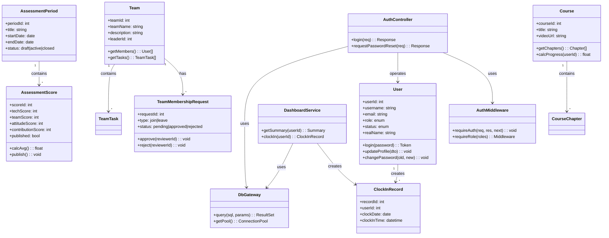

---

### 2.2 领域实体类（Entity）细化

#### 2.2.1 User（用户）

| 属性 | 类型 | 说明 |
|------|------|------|
| userId | INT | 主键 |
| username | NVARCHAR(50) | 登录名，唯一 |
| email | NVARCHAR(100) | 邮箱，唯一 |
| passwordHash | NVARCHAR(255) | bcrypt 哈希 |
| role | admin \| member | 角色 |
| status | pending \| active \| rejected | 账号状态 |
| realName, studentNo, phone, avatar, bio | — | 个人信息 |

| 方法 | 说明 |
|------|------|
| validatePassword(plain) | bcrypt 比对 |
| canLogin() | status == active |
| isAdmin() | role == admin |

**关联**：1 — * ClockInRecord；1 — * AssessmentScore；* — * Team（经 TeamMembers）

---

#### 2.2.2 Team / TeamTask / TeamMembershipRequest（团队）

**Team**

| 属性 | teamId, teamName, description, leaderId, createdAt |
| 方法 | addMember(userId), removeMember(userId), listTasks() |

**TeamTask**

| 属性 | taskId, teamId, title, description, status(todo/doing/done), assigneeId, creatorId |
| 方法 | updateStatus(status), canEditBy(user, role) |

**TeamMembershipRequest**

| 属性 | requestId, teamId, userId, type(join/leave), status, reviewerId |
| 方法 | approve(), reject() → 触发成员表增删 |

---

#### 2.2.3 AssessmentPeriod / AssessmentScore（考核）

**AssessmentPeriod**：periodId, title, startDate, endDate, status(draft/active/closed)

**AssessmentScore**

| 属性 | 四维分数 0–100、comment、published |
| 方法 | calcAvg() = (tech+team+attitude+contribution)/4；publish() 设置 published=true |

**约束**：同一 periodId + userId 唯一（Upsert）。

---

#### 2.2.4 Course / CourseChapter / LearningProgress（课程）

**Course**：courseId, title, category, videoUrl(MP4), difficulty, status

**CourseChapter**：chapterId, courseId, title, content, sortOrder, durationMin

**LearningProgress**：userId + chapterId 唯一，标记章节完成

| 方法 | 说明 |
|------|------|
| Course.calcProgress(userId) | 已完成章节数 / 总章节数 × 100% |

---

#### 2.2.5 ClockInRecord（打卡）

| 属性 | recordId, userId, clockDate, clockInTime |
| 约束 | UNIQUE(userId, clockDate) — 每日一次 |
| 方法 | static existsToday(userId): boolean |

---

#### 2.2.6 PasswordResetRequest（密码找回）

| 属性 | requestId, userId, newPasswordHash, status, reviewerId |
| 方法 | approve() → 更新 User.passwordHash；reject() → 仅改状态 |

---

#### 2.2.7 Announcement（公告）

| 属性 | announcementId, title, content, publisherId, createdAt |

---

### 2.3 控制类（Control）细化

| 类名 | 职责 | 源文件 |
|------|------|--------|
| AuthController | 登录、密码找回申请 | routes/auth.js |
| UserController | 个人信息、账号 CRUD、密码审核 | routes/users.js |
| DashboardController | 统计聚合、打卡 | routes/dashboard.js |
| TeamController | 团队、任务、申请审核 | routes/teams.js |
| AssessmentController | 周期、成绩录入发布 | routes/assessments.js |
| CourseController | 课程章节、进度、视频上传 | routes/courses.js |
| AnnouncementController | 公告 CRUD | routes/announcements.js |
| AuthMiddleware | JWT 解析、角色校验 | middleware/auth.js |
| VideoPrepareService | 演示 MP4 同步 | utils/videoPrepare.js |
| DbGateway | 连接池、参数化 SQL | config/db.js |

---

### 2.4 边界类（Boundary）细化 — 前端

| 边界类 | 路由 | 主要交互对象 |
|--------|------|--------------|
| AuthEntryView | /login | AuthController |
| DashboardView | /dashboard | DashboardController |
| CourseVideoView | /courses/videos | CourseController |
| AssessmentView | /assessment | AssessmentController |
| TeamsView / TeamOverviewView / TeamDetailView | /teams/* | TeamController |
| CoursesView / CourseDetailView | /courses/* | CourseController |
| AccountsView | /admin/accounts | UserController |
| PasswordResetsView | /admin/password-resets | UserController |
| ClockInView | /admin/clock-in | DashboardController |
| MainLayout | 布局壳 | UserStore（Pinia） |
| ApiClient | HTTP 封装 | 全部 Controller |

---

### 2.5 对象关系汇总（ER → 对象映射）

| 关系 | 多重性 | 说明 |
|------|--------|------|
| User — Team | * : * | 经 TeamMembers 关联 |
| User — TeamMembershipRequest | 1 : * | 用户发起申请 |
| Team — TeamTask | 1 : * | 团队包含任务 |
| User — AssessmentScore | 1 : * | 用户有多条考核成绩 |
| AssessmentPeriod — AssessmentScore | 1 : * | 周期包含成绩 |
| Course — CourseChapter | 1 : * | 课程包含章节 |
| User — LearningProgress | 1 : * | 用户学习进度 |
| User — ClockInRecord | 1 : * | 用户打卡记录 |
| User — PasswordResetRequest | 1 : * | 密码找回申请 |
| User — Announcement | 1 : * | 管理员发布公告 |

---

### 2.6 类图 — 认证与账号子系统

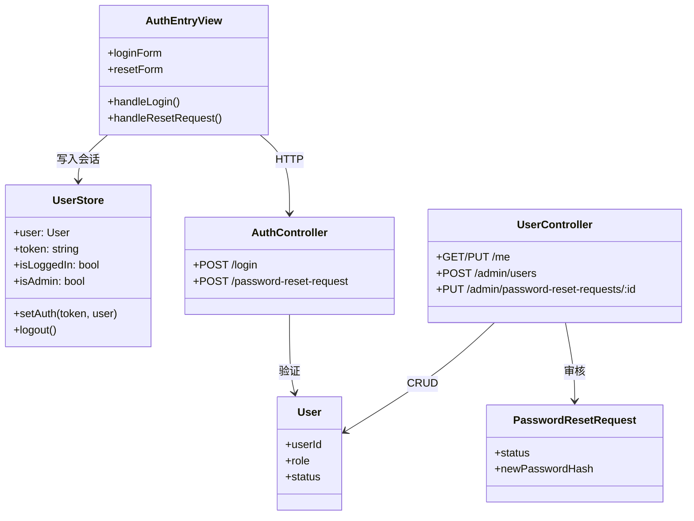

---

## 3. 细化的动态模型

动态模型描述对象在运行时的**交互顺序**、**状态变迁**与**活动流程**。

### 3.1 顺序图（Sequence Diagram）

#### 3.1.1 用户登录

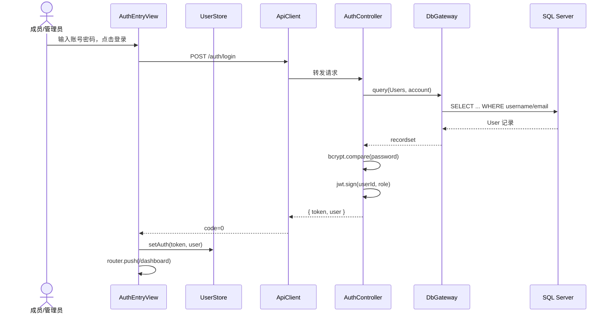

---

#### 3.1.2 每日打卡

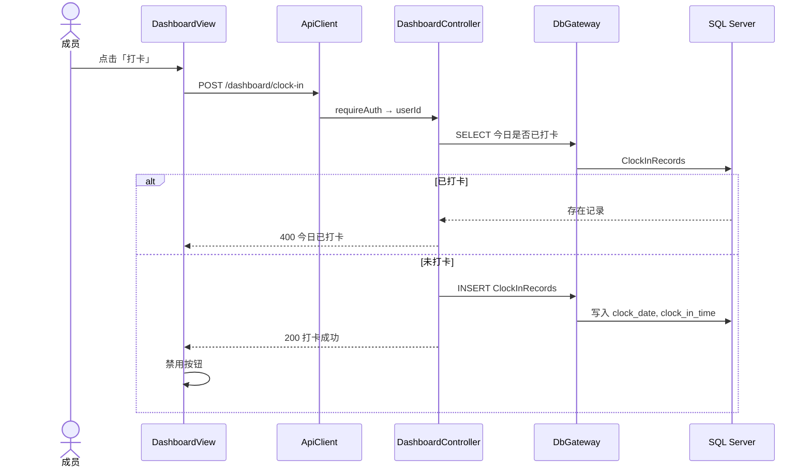

---

#### 3.1.3 团队加入申请与审核

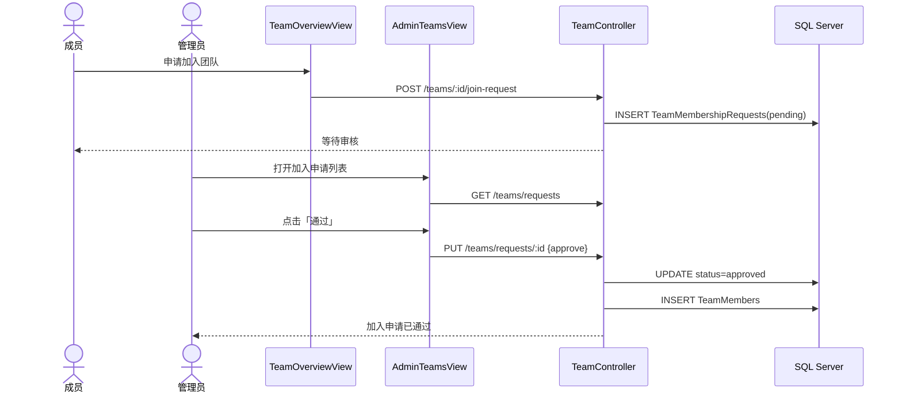

---

#### 3.1.4 密码找回审核

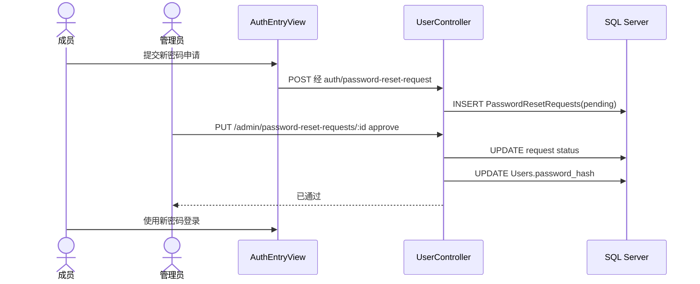

---

#### 3.1.5 课程 MP4 视频播放

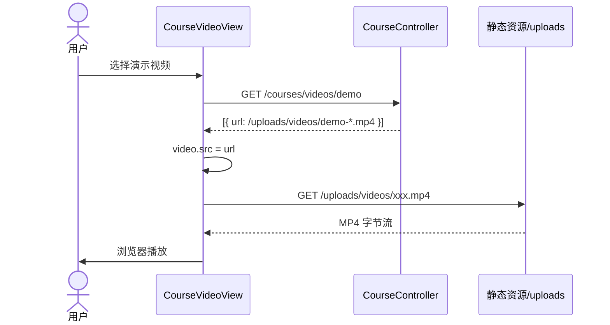

---

#### 3.1.6 考核成绩发布

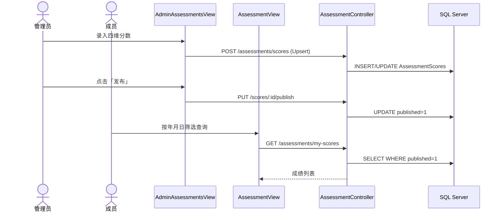

---

### 3.2 状态图（State Diagram）

#### 3.2.1 用户账号状态

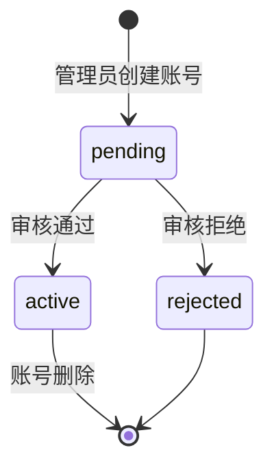

#### 3.2.2 密码找回申请状态

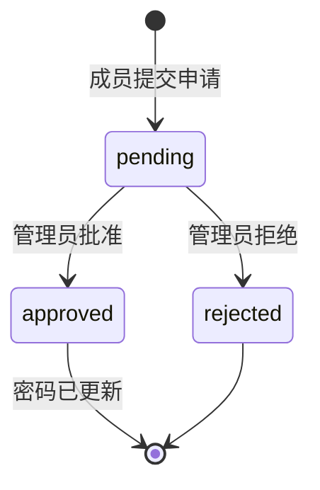

#### 3.2.3 团队成员申请状态

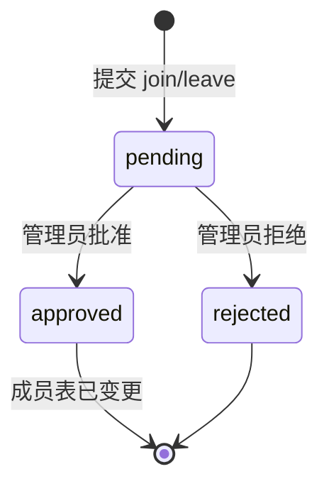

#### 3.2.4 考核周期状态

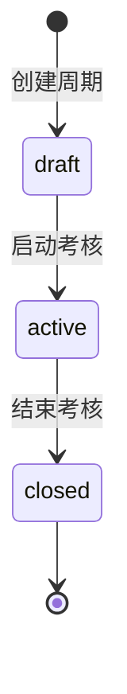

#### 3.2.5 团队任务状态

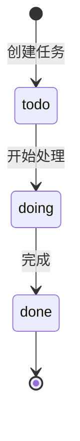

#### 3.2.6 考核成绩发布状态

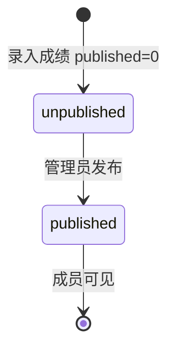

---

### 3.3 活动图（Activity Diagram）

#### 3.3.1 成员日常使用主流程

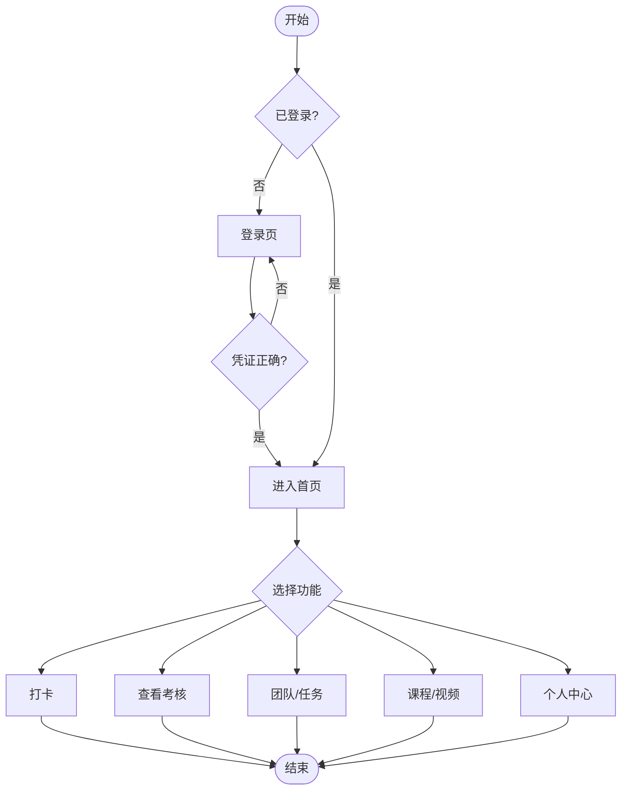

#### 3.3.2 管理员审核流程

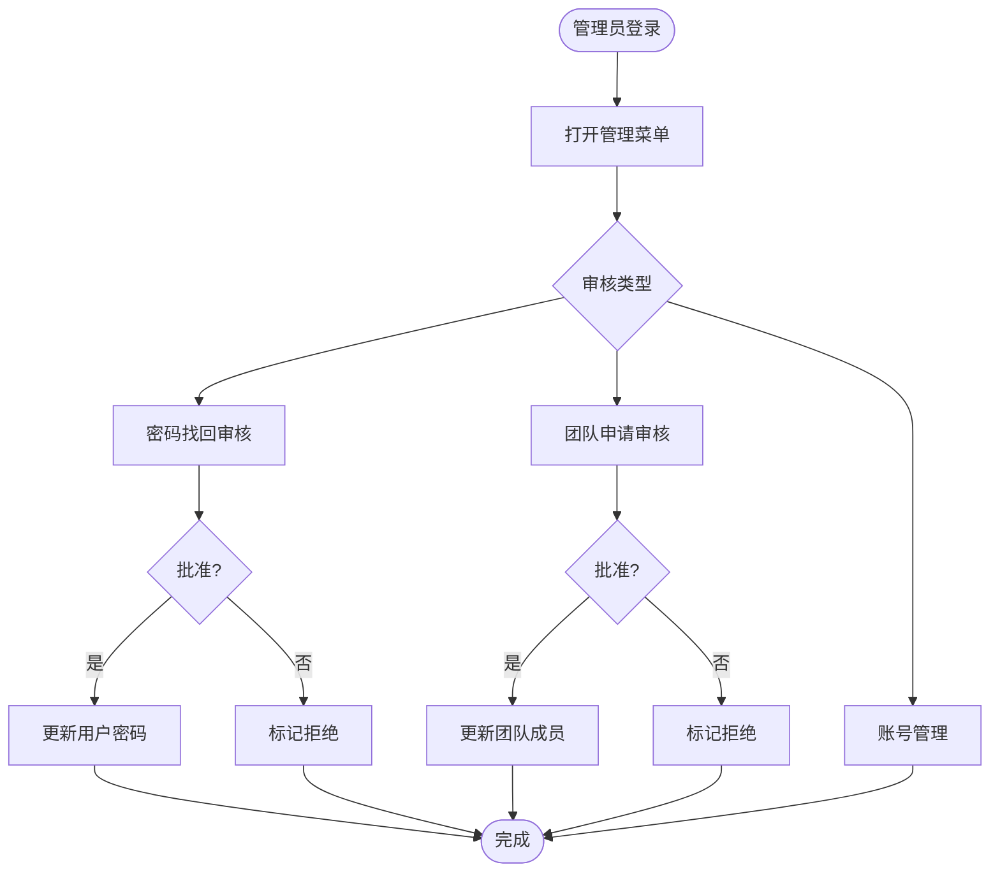

---

### 3.4 对象协作说明

| 场景 | 协作对象链 |
|------|------------|
| 登录 | AuthEntryView → ApiClient → AuthController → DbGateway → User |
| 权限拦截 | ApiClient → AuthMiddleware → 业务 Controller |
| 打卡 | DashboardView → DashboardController → ClockInRecord → DbGateway |
| 视频 | CourseVideoView → CourseController / 静态 FS → MP4 文件 |
| 团队审核 | AdminTeamsView → TeamController → TeamMembershipRequest → TeamMembers |

---

## 4. 细化的功能模型

功能模型从**用户视角**与**数据视角**描述系统做什么、数据如何流动、功能如何分解。

### 4.1 用例图（Use Case）

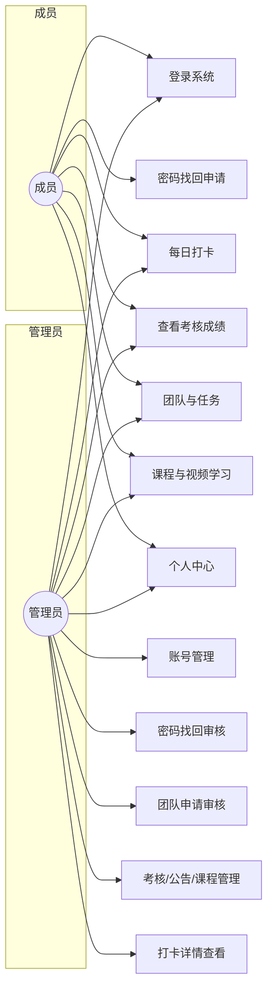

---

### 4.2 功能分解树

```
软件开发办公室内部管理系统
├── 1. 认证与账号
│   ├── 1.1 用户登录（JWT）
│   ├── 1.2 密码找回申请
│   ├── 1.3 管理员创建/编辑/删除账号
│   └── 1.4 密码找回审核
├── 2. 首页仪表盘
│   ├── 2.1 统计卡片（团队/课程/考核/公告）
│   ├── 2.2 公告与动态展示
│   └── 2.3 每日打卡
├── 3. 个人中心
│   ├── 3.1 信息维护
│   ├── 3.2 修改密码
│   └── 3.3 考核/学习摘要
├── 4. 考核系统
│   ├── 4.1 成员：时间轴查询已发布成绩
│   └── 4.2 管理员：周期管理、录入、发布
├── 5. 团队管理
│   ├── 5.1 我的团队 / 团队详情 / 任务看板
│   ├── 5.2 项目团队总览与加入/退出申请
│   └── 5.3 管理员：团队 CRUD、申请审核
├── 6. 课程学习
│   ├── 6.1 课程列表与章节进度
│   ├── 6.2 MP4 视频播放
│   └── 6.3 管理员：课程/章节/视频上传
├── 7. 公告管理（管理员）
└── 8. 打卡管理（管理员查看全员）
```

---

### 4.3 数据流图（DFD）

#### 4.3.1 顶层 DFD（0 层 / 上下文图）

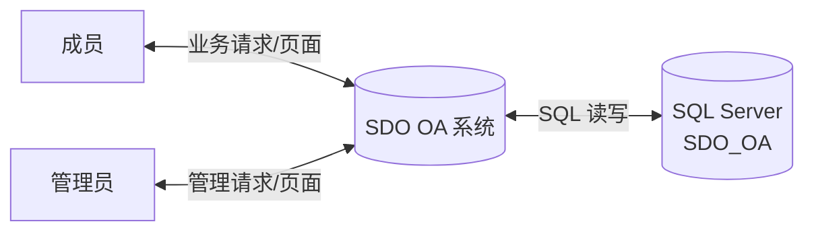

**外部实体**：成员、管理员  
**数据存储**：SDO_OA 数据库  
**系统边界**：Express API + Vue 前端

---

#### 4.3.2 一层 DFD

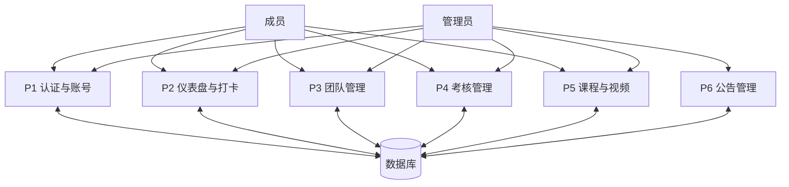

| 加工 | 输入 | 输出 | 涉及数据存储 |
|------|------|------|--------------|
| P1 认证与账号 | 账号密码、申请/审核指令 | Token、用户资料 | Users, PasswordResetRequests |
| P2 仪表盘与打卡 | userId | 统计、公告、动态、打卡结果 | Announcements, ClockInRecords, 多表聚合 |
| P3 团队管理 | 团队/任务/申请数据 | 团队列表、看板、审核结果 | Teams, TeamMembers, TeamTasks, TeamMembershipRequests |
| P4 考核管理 | 周期/分数/筛选条件 | 成绩、周期列表 | AssessmentPeriods, AssessmentScores |
| P5 课程与视频 | 课程/章节/MP4 | 进度、播放 URL | Courses, CourseChapters, LearningProgress, 文件系统 |
| P6 公告管理 | 公告 CRUD | 公告列表 | Announcements |

---

#### 4.3.3 二层 DFD 示例 — P2 仪表盘与打卡

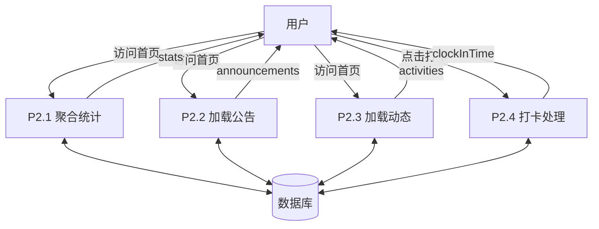

---

### 4.4 模块 IPO 表（功能模型细化）

#### P1 认证与账号

| | |
|---|---|
| **输入** | account, password；密码找回：account, new_password；管理员：用户 DTO、审核 action |
| **处理** | 参数校验 → 查库 → bcrypt/JWT → 申请/审核状态机 |
| **输出** | token + user；或操作成功/失败消息 |

#### P2 仪表盘与打卡

| | |
|---|---|
| **输入** | userId（JWT） |
| **处理** | 多表 COUNT/UNION；打卡查重 + INSERT |
| **输出** | stats, announcements, activities；clockedIn, clockInTime |

#### P3 团队管理

| | |
|---|---|
| **输入** | teamId, userId, 任务/申请 DTO |
| **处理** | 成员关系维护；申请 approve → 增删 TeamMembers；任务权限判断 |
| **输出** | 团队/成员/任务列表；审核消息 |

#### P4 考核管理

| | |
|---|---|
| **输入** | periodId, userId, 四维分数, year/month/day 筛选 |
| **处理** | Upsert 成绩；publish；按 end_date 动态 SQL 筛选 |
| **输出** | 周期列表、成绩（含 avg_score） |

#### P5 课程与视频

| | |
|---|---|
| **输入** | courseId, chapterId, MP4 文件 |
| **处理** | 进度幂等 INSERT；MP4 上传与演示同步；仅 MP4 可播放 |
| **输出** | 课程详情、progress_pct、video url |

#### P6 公告管理

| | |
|---|---|
| **输入** | title, content, publisherId |
| **处理** | CRUD Announcements |
| **输出** | 公告列表 |

---

### 4.5 功能与对象/接口映射

| 功能编号 | 功能名称 | 主要实体对象 | API 前缀 |
|----------|----------|--------------|----------|
| 1.x | 认证与账号 | User, PasswordResetRequest | /auth, /users |
| 2.x | 仪表盘与打卡 | ClockInRecord, Announcement | /dashboard |
| 3.x | 个人中心 | User | /users/me |
| 4.x | 考核 | AssessmentPeriod, AssessmentScore | /assessments |
| 5.x | 团队 | Team, TeamTask, TeamMembershipRequest | /teams |
| 6.x | 课程与视频 | Course, CourseChapter, LearningProgress | /courses |
| 7.x | 公告 | Announcement | /announcements |

---

## 5. 三种模型的对应关系

| 功能（功能模型） | 参与对象（对象模型） | 交互过程（动态模型） |
|------------------|----------------------|----------------------|
| 用户登录 | User, AuthController, UserStore | 顺序图 3.1.1 |
| 每日打卡 | ClockInRecord, DashboardController | 顺序图 3.1.2、状态无（一次性写入） |
| 团队加入审核 | Team, TeamMembershipRequest | 顺序图 3.1.3、状态图 3.2.3 |
| 密码找回 | PasswordResetRequest, User | 顺序图 3.1.4、状态图 3.2.2 |
| 视频播放 | Course, CourseVideoView, MP4 文件 | 顺序图 3.1.5 |
| 考核发布 | AssessmentScore | 顺序图 3.1.6、状态图 3.2.6 |
| 系统总功能 | 功能分解树 4.2 | 用例图 4.1、DFD 4.3 |

---

## 6. 文档修订记录

| 版本 | 日期 | 说明 |
|------|------|------|
| v1.0 | 2026-06-17 | 初始版本，含对象/动态/功能三类细化模型 |
